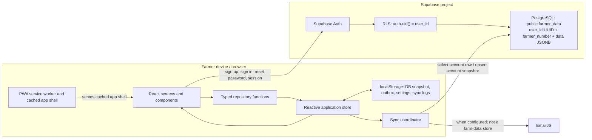
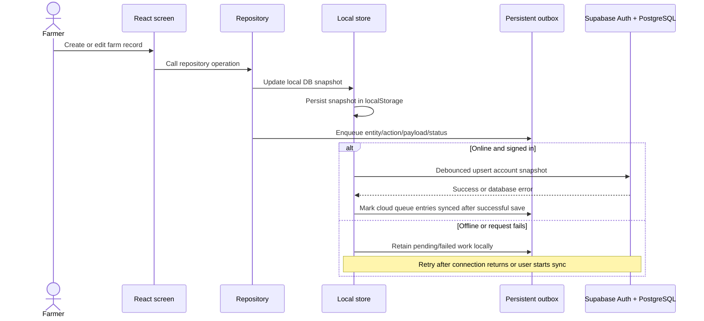

# AgriSync Project Documentation

## Rice Farm Expense Recording and Monitoring System

**Project type:** Mini Capstone — System Integration and Architecture  
**Proponents:** Reniel B. Agtas and Kurt Ivan Samillano  
**Course:** Bachelor of Science in Information Technology  
**Project/Subject:** Mini Capstone — System Integration and Architecture  
**Student ID (as listed in proposal):** 2023-351  
**Advisor/Instructor (as listed in proposal):** Daffodelle V. Lucena  
**Proposal date:** September 9, 2026  
**Institution:** Add the official school/college name before submission; it is not specified in the available project files.  
**Documentation status:** Describes the repository implementation. Live Supabase, provider, and device tests are explicitly identified as unverified where applicable.

---

## 1. Executive Summary

AgriSync is an installable, responsive web application for recording rice-farm and farmer-finance information. It brings farmer profiles, plots, visits, cash advances and repayments, expenses, harvests, budgets, and analytics into one application.

The application combines a React and TypeScript frontend, a browser-persisted local store, Supabase Authentication, and a Supabase PostgreSQL account-data table. Previously authenticated users can use locally cached records while disconnected; account changes are saved locally and can be uploaded when connectivity returns. A persistent outbox tracks queued work. Optional cash-advance email updates use EmailJS when configured. AgriSync does not send SMS or provide USSD/mobile-money functionality; the farmer contact action can open the device's native messaging application.

The current cloud data model intentionally preserves the repository's existing JSONB design: all farm records for one account are stored in one `farmer_data.data` document. This is not a normalized relational schema. The account row is protected by Row Level Security (RLS), but individual JSON objects do not have PostgreSQL foreign keys or independent RLS policies.

This project demonstrates a practical frontend-to-cloud integration and offline-capable workflow. It should not be described as a fully normalized production backend, multi-device conflict-resolution system, or multi-channel messaging platform.

## 2. Problem Definition

Smallholder farmers and agricultural field staff need to collect records where connectivity may be unreliable. Paper records and disconnected spreadsheets make it difficult to review the combined history of farm activities and costs. Applications that require an online request for every operation are also difficult to use in low-connectivity settings.

### Integration problem

The solution connects:

1. The AgriSync PWA and its local data store.
2. Supabase Auth for account creation, sign-in, session persistence, and password recovery.
3. Supabase PostgreSQL for account-scoped cloud persistence.
4. Browser storage and the service worker for cached application use and queued offline changes.
5. Optional EmailJS delivery for cash-advance email updates.

### Desired outcome

Provide a single interface where a farmer can maintain farm and finance records, review summaries, and save the account snapshot to Supabase when online—without losing already-cached work merely because the network is unavailable.

### Project objectives

- Preserve the existing React, TypeScript, repository, store, PWA, and UI architecture.
- Authenticate accounts with Supabase Auth and keep the Auth UUID as the internal account identity.
- Restrict cloud access to the signed-in account using RLS.
- Keep previously loaded data available locally and queue supported changes for synchronization.
- Provide farmer, plot, visit, finance, and analytics screens using application data.
- Document integration behavior, setup, testing evidence, and limitations accurately.

## 3. Scope and Delimitations

### Included in the current application

- Supabase email/password registration and login.
- Supabase password-recovery flow and protected application routes.
- Farmer profiles and farm plot management.
- Farmer visits, cash advances, repayments, expenses, harvests, and seasonal budgets.
- Dashboard and analytics calculated from the application database held in the local store.
- Browser persistence, a persistent local outbox, sync status, retry controls, account backup and restore.
- PWA manifest and generated service worker for installation and app-shell caching.
- Optional EmailJS email delivery for cash-advance updates when configured in Settings.
- Native SMS-app handoff initiated by the user; AgriSync itself does not send messages.

### Not implemented as cloud relational features

- Separate PostgreSQL tables and foreign keys for each farm record type.
- Per-record RLS policies or independent database operations for nested JSON records.
- Robust concurrent multi-device synchronization or conflict resolution.
- Direct SMS, USSD, or mobile-money provider integration.
- Server-side analytics or Edge Functions.
- Automated unit, integration, or browser end-to-end test suites in this repository.
- Automatic migration of old MySQL or unlinked legacy browser data into a Supabase account.

## 4. Architecture and Design

### 4.1 Architecture style

AgriSync uses a client-side, local-first architecture with a repository abstraction and a Supabase cloud persistence boundary:

- **Presentation:** React screens and components.
- **Domain:** TypeScript types for application records and state.
- **Repository:** functions mutate the local application database and enqueue outbox items.
- **State and persistence:** a `useSyncExternalStore`-based store persisted in browser `localStorage`.
- **Cloud adapter:** Supabase JavaScript client, Auth, and account-row read/upsert.
- **Synchronization:** a coordinator saves the account snapshot and updates queue status.
- **PWA runtime:** Vite PWA plugin, manifest, and Workbox service worker.
- **Optional notifications:** EmailJS for configured cash-advance emails.

### 4.2 Architecture diagram



### 4.3 Data and synchronization workflow



**Important implementation detail:** queue entries describe individual local changes, but farm data is uploaded as a complete account snapshot with an upsert on `user_id`. The application does not execute one Supabase `insert`, `update`, or `delete` for each nested record. This supports retrying the same account write without creating duplicate account rows, but it does not provide record-level merge semantics.

## 5. Data Model and Mapping

### 5.1 Cloud table

The current SQL migrations create or extend one table:

| Column | Meaning | Key/constraint |
|---|---|---|
| `user_id` | Supabase Auth account UUID | Primary key; references `auth.users(id)` with `ON DELETE CASCADE` |
| `data` | JSONB account snapshot | Not null; contains the application record collections |
| `farmer_number` | Sequential numeric account number | Added by the second migration; unique with a sequence default |

RLS is enabled on `farmer_data`. The policy allows authenticated access to a row only when `auth.uid()` equals that row's `user_id`. The migration uses additive DDL and does not drop existing tables or farmer rows.

### 5.2 JSON record collections

| JSON property | TypeScript model | Relationship represented in JSON |
|---|---|---|
| `farmers` | `Farmer[]` | Farmer profile records |
| `plots` | `Plot[]` | `farmerId` points to a farmer profile ID |
| `visits` | `Visit[]` | `farmerId` points to a farmer profile ID |
| `cashAdvances` | `CashAdvance[]` | `farmerId` points to a farmer profile ID |
| `expenses` | `Expense[]` | `farmerId` points to a farmer profile ID |
| `harvests` | `Harvest[]` | `farmerId` points to a farmer profile ID |
| `budgets` | `SeasonBudget[]` | `farmerId` points to a farmer profile ID |
| Nested in `cashAdvances` | `Repayment[]`, notes, and email history | Repayments point to a cash-advance ID; notes and email history belong to the advance |

These are application-level references inside JSON, not database-enforced foreign keys. A farmer profile's generated string ID is distinct from the Supabase Auth UUID and the numeric `farmer_number`.

### 5.3 Identity mapping

| Identity | Format | Purpose |
|---|---|---|
| Supabase Auth `user.id` | UUID | Internal authenticated account ID and `farmer_data.user_id` |
| Farmer profile `id` | App-generated string ID | Identifies a profile in JSON record collections and related records |
| `farmer_number` | Sequential integer | Human-readable account number shown in Settings |

Passwords are handled by Supabase Auth. The application does not write passwords to the `farmer_data` row.

### 5.4 Transformations and validation

- The Supabase adapter validates that expected record collections are arrays before exposing them as application state.
- Legacy expenses without a season receive a default season when loaded.
- Legacy cash-advance kind values and missing repayment fields are normalized by the local store.
- Input forms validate key values such as farm size, expenses, harvest quantity, budget amount, and repayment amount before saving.
- Account backups are checked for supported format/version, duplicate IDs, record validity, and farmer IDs belonging to the signed-in account.
- The database layer stores a whole JSON snapshot and does not enforce detailed validation constraints as normalized SQL columns would.

## 6. Integration Implementation

### 6.1 Supabase Auth

The frontend uses `@supabase/supabase-js` and the public client configuration variables:

- `VITE_SUPABASE_URL`
- `VITE_SUPABASE_ANON_KEY`

The application restores a Supabase session during startup, uses email/password sign-in and sign-up, supports password reset, and protects farmer pages behind authentication. The browser anon/publishable key is expected to be public; a Supabase service-role key must never be shipped to the frontend.

First-time cloud registration and login require internet. Offline use is limited to previously authenticated users with a locally cached app and records; it does not make Supabase cloud authentication available offline.

### 6.2 Cloud persistence

The adapter reads the signed-in account row from `farmer_data` and writes it using:

```ts
upsert({ user_id: userId, data: db }, { onConflict: 'user_id' })
```

Supabase errors are thrown from the adapter and reflected in the store's database-save error status. Writes are debounced and serialized. A manual sync control is also available.

### 6.3 Offline persistence and outbox

The browser store persists the database snapshot and outbox to `localStorage`. Repository operations update the local snapshot first and enqueue an item with an entity, action, payload, status, attempt count, and timestamp. Cloud-channel work is treated as synchronized after the Supabase account snapshot save succeeds. Failed cloud saves remain visible/retryable; the `online` event attempts a save for the active account.

The app's current persistence is browser `localStorage`, not an encrypted database. Device access and browser profile security matter, especially on shared devices. Clearing browser storage can remove unsynchronized local work.

The old simulated SMS/USSD queue and simulation history are removed during local-state normalization. This cleanup does not delete farmer, expense, repayment, plot, visit, harvest, or budget records. Historical SMS data embedded in account records is preserved as legacy data and is not treated as proof that an SMS was sent.

### 6.4 Notifications and external services

- **SMS:** AgriSync does not send SMS. The farmer contact action hands off to the device's native messaging application; actual sending is controlled by the user and their device/provider.
- **USSD/mobile money:** not provided by AgriSync.
- **Email:** cash-advance email notifications use EmailJS only when its service ID, template ID, and public key have been configured in Settings. Unconfigured attempts and provider errors remain visibly failed; they are not reported as sent.
- **Supabase:** used for Auth and account snapshot storage.

The EmailJS public key is intended for browser use. Do not enter private provider credentials or a Supabase service-role key into the frontend settings.

### 6.5 Deployment compatibility

Vite produces the production bundle in `dist/`. The repository includes Vercel and Netlify deployment configuration. Vercel rewrites application routes to `index.html`; the Vite PWA plugin generates the manifest and service worker. Production environment variables and Auth redirect URLs must be configured at the hosting provider and in Supabase Auth settings.

## 7. Error Handling, Retries, and Monitoring

| Condition | Current handling |
|---|---|
| Supabase environment variables missing | Client setup reports that the database is not configured; cloud features cannot be used |
| Cloud request or RLS failure | Supabase adapter throws the error; store updates database save status and reports the database error |
| Offline edit | Data remains in local browser storage and queue; cloud sync waits for connectivity |
| Reconnection | Store marks the device online and attempts account snapshot synchronization |
| Manual retry | Sync Center offers retry actions for failed queue items and a manual account sync control |
| EmailJS not configured or request fails | Email queue item is marked failed with an explanation and can be retried after configuration or error resolution |
| Invalid form values | Relevant screens/repository functions show errors or reject invalid values |
| Expired or ended session | Auth state listener clears authenticated app state on Supabase sign-out event |
| Local storage access failure | Error is logged and a storage-error event is dispatched; browser quota/security limitations remain possible |
| Concurrent edits from multiple devices | No robust merge/conflict-resolution strategy; simultaneous snapshot upserts may overwrite changes |

Sync Center shows the database save status, queue status, retry controls, and local sync history. The sync history is local to the browser and is not a centralized server audit log.

## 8. User Instructions

### First-time setup and sign-in

1. Configure the Supabase project and environment variables as described in Section 10.
2. Open the hosted app while connected to the internet.
3. Register with the account form or sign in with an existing Supabase account.
4. Confirm email if email confirmation is enabled for the Supabase project.
5. Use the protected screens to manage the farmer profile and records.

### Offline use

1. Sign in and open the application while online so the PWA shell and records can be cached.
2. When offline, use the same browser profile/device to view locally available records and make supported edits.
3. Check Sync Center for pending or failed items.
4. Reconnect to the internet and allow the app to synchronize, or run account sync manually.
5. Confirm the database status indicates a successful save before relying on another device or signing out.

Offline access is not first-time authentication. The local browser copy is not encrypted by this application.

### EmailJS setup

1. Create/configure an EmailJS service and template outside AgriSync.
2. Ensure the template accepts `to_email`, `subject`, and `message` values.
3. Enter the EmailJS service ID, template ID, and public key in Settings and save.
4. Trigger an email notification and verify delivery in the recipient inbox and EmailJS dashboard.
5. If configuration is incomplete or delivery fails, Sync Center shows the item as failed; resolve the issue and retry it.

EmailJS delivery is external-provider functionality and has not been verified without the project's own provider configuration.

### Backups and reports

- Download an account backup from Sync Center and store it securely.
- Restore only a valid backup containing farmer profile IDs permitted for the signed-in account. Restore replaces that account's local snapshot and, when online, uploads it.
- Finance reports can be exported as CSV or printed/saved to PDF.

## 9. Testing and Validation

### 9.1 Repository-level checks

| Check | Result | What it establishes |
|---|---|---|
| `npm run build` | Passed | TypeScript project build and Vite production bundle complete |
| `npm run lint` | Passed | ESLint reports no lint errors |
| `git diff --check` | Passed | No whitespace errors in the code changes checked |

The production build reports a large JavaScript chunk warning (>500 kB minified). This is a performance optimization warning, not a build failure.

No automated test files/framework were found in the repository. The checks above do not test live Supabase behavior.

### 9.2 Integration test plan and evidence status

The following scenarios should be run using a configured test Supabase project before a final defense. They are **not claimed as passed** unless recorded by the project team after execution.

| ID | Scenario | Expected result | Current evidence |
|---|---|---|---|
| AUTH-01 | Register a new test account online | Supabase creates the Auth user; app follows configured email confirmation/session flow | Not verified against live project |
| AUTH-02 | Sign in with valid and invalid credentials | Valid user reaches protected app; invalid credentials show an error | Not verified against live project |
| AUTH-03 | Request password reset and follow link | Supabase email redirects to configured reset route | Not verified; requires mail and redirect configuration |
| RLS-01 | Account A attempts to access account B's `farmer_data` row | RLS denies cross-account read/write | Not verified using two test accounts |
| CRUD-01 | Create/update/delete each supported record category | Local display updates; successful sync survives reload | Not verified end-to-end |
| SYNC-01 | Edit while offline, then reconnect | Local record remains; account snapshot uploads; pending cloud items transition to synced | Not verified in deployed browser |
| SYNC-02 | Force a failed cloud request and retry | Failure is visible; local data is retained; later successful retry saves snapshot | Not verified against live project |
| DATA-01 | Repeat synchronization of same snapshot | One `farmer_data` account row remains due to `user_id` upsert conflict key | Database behavior not integration-tested |
| DATA-02 | Apply both migrations to an existing database with sample rows | Existing account rows remain; farmer numbers are backfilled and unique | Not verified on production-like database |
| PWA-01 | Install app online, reopen offline | Cached app shell starts; previously cached local data is visible | Not verified on target mobile devices |
| REPORT-01 | Compare seasonal totals with source records | Harvest income equals quantity × price; expense and budget totals match records | Not verified with a formal test dataset |
| EMAIL-01 | Configure EmailJS and send a test email | Email arrives and errors are visible on failure | Not verified; provider configuration required |
| EMAIL-02 | Trigger an email notification without EmailJS configuration | Queue item is marked failed with a configuration message; no success is reported | Code path implemented; not verified in browser |

### 9.3 Suggested test record

For each manual test, record the date, build/deployment URL, browser/device, test account label (never its password), steps, expected result, actual result, pass/fail, and screenshot or log reference. Do not include passwords, access tokens, or service-role credentials in submitted evidence.

| Field | Record |
|---|---|
| Test ID and scenario |  |
| Date/time and tester |  |
| Build/version and deployment URL |  |
| Browser/device and network condition |  |
| Test account label (no password or tokens) |  |
| Steps performed |  |
| Expected result |  |
| Actual result |  |
| Result (Pass / Fail / Blocked) |  |
| Evidence filename or reference |  |
| Defect/follow-up |  |

### 9.4 Owner verification still required

The repository-level build and lint checks listed in Section 9.1 have been run. Documentation content, architecture, and data mapping were prepared from the project source files. The following items require access to the project team's Supabase/hosting configuration or actual browser/device testing and must be completed by a project team member:

- Confirm the official school name, final course label, adviser name, authors' names/IDs, and required title-page format.
- Apply the additive SQL migrations in a test Supabase project and confirm that existing test rows remain intact and farmer numbers are unique.
- Configure and verify the Supabase Auth redirect URLs and registration/email-confirmation policy.
- Execute AUTH-01 through AUTH-03 and RLS-01 in Section 9.2 using test accounts; record outcomes and evidence.
- Execute CRUD-01, SYNC-01, SYNC-02, and DATA-01/02 using test data; record outcomes and evidence. Use only a disposable test project/account for destructive CRUD checks.
- Execute PWA-01 on the target device/browser after an online installation; record offline/reconnect results.
- Execute REPORT-01 and, if email is part of the demo, EMAIL-01/02; record outcomes and evidence.
- Replace each “Not verified” status in the test table only after performing that specific test. Mark blocked items as blocked and state the reason; never infer a pass from build/lint success.
- Open the final `.docx` in Microsoft Word and inspect its layout, page breaks, tables, diagrams, title page, and printed/PDF output.

The authoring environment used for this documentation did not include a verified connection to the team's Supabase project, production hosting account, EmailJS provider account, or target mobile devices. No live database, RLS, email delivery, or deployed offline test result is asserted here.

## 10. Installation, Database Setup, and Deployment

### 10.1 Local development

Requirements: Node.js and npm.

```sh
npm install
npm run dev
```

Copy `.env.example` to `.env.local` and set the Supabase project URL and anon/publishable key. Restart Vite after changing environment variables.

### 10.2 Supabase SQL setup

Run the migrations in order in Supabase SQL Editor (or apply them using Supabase CLI):

1. [`supabase/migrations/20261021000000_create_farmer_data.sql`](./supabase/migrations/20261021000000_create_farmer_data.sql)
2. [`supabase/migrations/20261022000000_add_farmer_number.sql`](./supabase/migrations/20261022000000_add_farmer_number.sql)

The migrations are additive and do not drop existing tables or farmer rows. Back up important project data before any production schema change as a general operational precaution. After migration, verify the `farmer_data` table, its RLS policy, and the unique `farmer_number` index in the Supabase dashboard.

### 10.3 Supabase Auth settings

- Set the allowed site URL to the deployed HTTPS origin.
- Add local development and deployed application URLs to allowed redirect URLs.
- Allow the `/reset-password` redirect path.
- Configure email-confirmation policy and test confirmation links.

### 10.4 Vercel/PWA deployment

1. Set `VITE_SUPABASE_URL` and `VITE_SUPABASE_ANON_KEY` as deployment build environment variables.
2. Configure matching site and redirect URLs in Supabase Auth.
3. Deploy the production build and open the HTTPS URL once while online.
4. Install from the deployed site, not from a development server.
5. Test direct-route refresh, sign-in, cached app-shell launch, and offline behavior on target browsers.

The repository includes Vercel and Netlify configuration, but no external deployment is verified by this document.

## 11. Security and Data Protection

- Supabase Auth UUIDs identify accounts; the human-readable farmer number is separate.
- The database uses RLS to restrict each account row to the corresponding `auth.uid()`.
- Never put a Supabase service-role key in the browser, committed `.env.local`, or deployment frontend variables.
- The browser's local data is not encrypted by the app. Use a secured, trusted device and avoid shared browser profiles.
- Treat backup files as private financial and personal information.
- Apply SQL migrations only after reviewing the target Supabase project and migration order; this project's migrations do not drop table data.
- RLS protects the cloud account row, but does not solve data-at-rest exposure on the device or multi-device write conflicts.
- EmailJS browser configuration uses a public key; do not put private provider credentials in client settings.

## 12. Known Limitations and Future Improvements

### Current limitations

1. **Single JSONB account snapshot:** convenient for preserving current behavior and backup/restore, but unsuitable for SQL reporting at record level, granular updates, or large datasets.
2. **No nested foreign keys:** record relationships such as expense-to-farmer are represented in JSON and checked by application logic, not PostgreSQL constraints.
3. **Snapshot overwrite risk:** concurrent clients can overwrite a newer account snapshot; no version check, merge, or conflict UI currently exists.
4. **Browser storage:** localStorage is not encrypted and may be cleared or quota-limited.
5. **Communication channels:** direct SMS and USSD/mobile-money services are not provided. Email delivery depends on EmailJS configuration and external provider availability.
6. **Testing coverage:** build and lint are verified, but live Auth, RLS, migrations, PWA offline behavior, and full CRUD sync require manual integration tests.
7. **Legacy import:** old MySQL data and unowned browser data are not automatically imported into Supabase.

### Recommended next iteration

- Introduce normalized tables through additive migrations, with a staged data migration and verification plan that preserves existing JSON records.
- Add primary keys, foreign keys, useful indexes, constraints, and RLS policies for each table.
- Use stable client-generated UUIDs and idempotent upserts for record-level synchronization.
- Add revision/version columns or another explicit conflict policy for multi-device edits.
- Use IndexedDB for larger structured offline datasets and consider local encryption requirements.
- Add automated unit tests for repositories/transformations, integration tests against a Supabase test project, and browser tests for offline/reconnect workflows.
- Integrate an SMS provider only if required, using secure server-side credentials (for example, an Edge Function), not a browser secret.

## 13. Conclusion

AgriSync demonstrates a useful integration case: an installable React PWA, Supabase Auth, an RLS-protected PostgreSQL account row, a browser-persisted local store, and a synchronization queue. It supports the key project discussion areas—problem definition, architecture, data mapping, integration workflow, error behavior, testing plan, and deployment instructions.

The project should be presented as an **offline-capable, account-snapshot integration prototype**, not as a fully normalized production backend or as a live multi-channel messaging platform. The documented build and lint checks pass, while live Supabase and offline integration scenarios remain to be verified by the project team.

## 14. References

The following references support the technologies and patterns discussed in this documentation. The architecture and implementation descriptions are based on the AgriSync repository; external sources are not evidence that the project itself has passed integration testing.

1. Supabase. (n.d.). *Row Level Security*. https://supabase.com/docs/guides/database/postgres/row-level-security
2. Supabase. (n.d.). *Auth*. https://supabase.com/docs/guides/auth
3. Supabase. (n.d.). *JavaScript: upsert*. https://supabase.com/docs/reference/javascript/upsert
4. PostgreSQL Global Development Group. (n.d.). *JSON Types*. PostgreSQL Documentation, Section 8.14. https://www.postgresql.org/docs/current/datatype-json.html
5. React. (n.d.). *useSyncExternalStore*. https://react.dev/reference/react/useSyncExternalStore
6. Mozilla Developer Network. (n.d.). *Window: localStorage property*. https://developer.mozilla.org/en-US/docs/Web/API/Window/localStorage
7. Mozilla Developer Network. (n.d.). *Offline and background operation*. Progressive Web Apps. https://developer.mozilla.org/en-US/docs/Web/Progressive_web_apps/Guides/Offline_and_background_operation
8. Vite PWA. (n.d.). *Getting Started*. https://vite-pwa-org.netlify.app/guide/
9. Richardson, C. (2019). *Pattern: Transactional Outbox*. microservices.io. https://microservices.io/patterns/data/transactional-outbox.html
10. Kleppmann, M., Wiggins, A., van Hardenberg, A., & McGranaghan, N. (2019). Local-First Software: You Own Your Data, in Spite of the Cloud. *Proceedings of Onward! 2019*, 154–178.
11. Hartung, C., Lerer, A., Anokwa, Y., Tseng, C., Brunette, W., & Borriello, W. (2010). Open Data Kit: Tools to Build Information Services for Developing Regions. *Proceedings of ICTD '10*, Article 18.
12. Ater, T. (2017). *Building Progressive Web Apps*. O'Reilly Media.

## 15. Submission Checklist

### Prepared in the repository

- [x] Project documentation covering problem definition, scope, architecture, mapping, implementation, error handling, testing plan, deployment, limitations, and references.
- [x] Architecture and synchronization workflow diagrams in this Markdown document.
- [x] Existing project proposal and implementation source code.
- [x] Build and lint checks recorded as passed in this document.

### Complete before final submission

- [ ] Add/confirm the official school name and verify all title-page details.
- [ ] Run the live Supabase/Auth/RLS/CRUD/offline tests and attach truthful results/evidence.
- [ ] Review the final Word document in Microsoft Word and confirm diagrams, tables, title page, and page breaks.
- [ ] Prepare the separate presentation deliverable required by the project guidelines.
- [ ] Submit the project proposal, design artifacts, implementation code, test evidence, project documentation, and presentation together, as requested by the instructor.

Items in this final checklist remain unchecked because they require confirmation or test execution by the project team.
