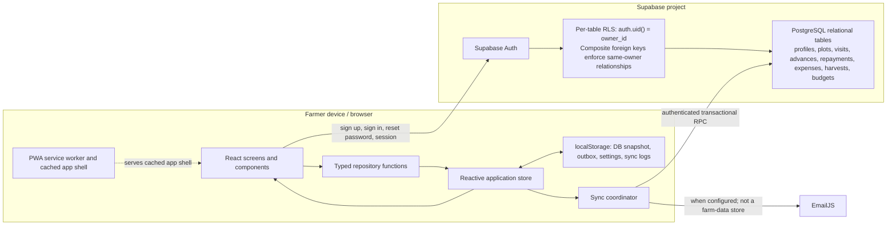
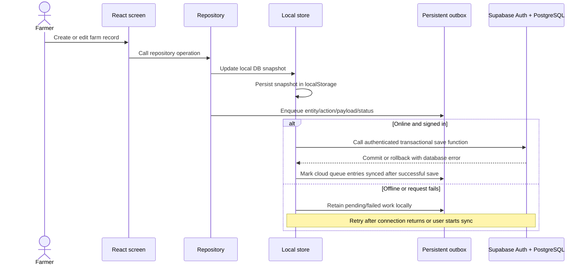

# AgriSync Project Documentation

## Rice Farm Expense Recording and Monitoring System

**Project type:** Mini Capstone — System Integration and Architecture  
**Proponents:** Reniel B. Agtas and Kurt Ivan Samillano  
**Course:** Bachelor of Science in Information Technology  
**Project/Subject:** Mini Capstone — System Integration and Architecture  
**Student ID (as listed in proposal):** 2023-351  
**Advisor/Instructor (as listed in proposal):** Daffodelle V. Lucena  
**Proposal date:** September 9, 2026  
**Institution:** Add the official school/college name before submission; it is not specified in the available project files.  
**Documentation status:** Describes the repository implementation. Live Supabase, provider, and device tests are explicitly identified as unverified where applicable.

---

## 1. Executive Summary

AgriSync is an installable, responsive web application for recording rice-farm and farmer-finance information. It brings farmer profiles, plots, visits, cash advances and repayments, expenses, harvests, budgets, and analytics into one application.

The application combines a React and TypeScript frontend, a browser-persisted local store, Supabase Authentication, and normalized Supabase PostgreSQL tables for farm records. Previously authenticated users can use locally cached records while disconnected; account changes are saved locally and can be uploaded when connectivity returns. A persistent outbox tracks queued work. Optional cash-advance email updates use EmailJS when configured. AgriSync does not send SMS or provide USSD/mobile-money functionality; the farmer contact action can open the device's native messaging application.

The current cloud data model uses relational tables with PostgreSQL foreign keys and per-table Row Level Security (RLS). A migration backfills existing account JSON into these tables and preserves the original `farmer_data.data` snapshot as a legacy archive. Auth UUID remains the account owner ID; the existing sequential `farmer_number` stays separate.

The system provides database-enforced referential integrity and atomic cloud synchronization. Concurrent multi-device edits still do not have field-level conflict merging, and SMS/USSD are not supported communication channels.

## 2. Problem Definition

Smallholder farmers and agricultural field staff need to collect records where connectivity may be unreliable. Paper records and disconnected spreadsheets make it difficult to review the combined history of farm activities and costs. Applications that require an online request for every operation are also difficult to use in low-connectivity settings.

### Integration problem

The solution connects:

1. The AgriSync PWA and its local data store.
2. Supabase Auth for account creation, sign-in, session persistence, and password recovery.
3. Supabase PostgreSQL for account-scoped cloud persistence.
4. Browser storage and the service worker for cached application use and queued offline changes.
5. Optional EmailJS delivery for cash-advance email updates.

### Desired outcome

Provide a single interface where a farmer can maintain farm and finance records, review summaries, and synchronize relational records with Supabase when online—without losing already-cached work merely because the network is unavailable.

### Project objectives

- Preserve the existing React, TypeScript, repository, store, PWA, and UI architecture.
- Authenticate accounts with Supabase Auth and keep the Auth UUID as the internal account identity.
- Restrict cloud access to the signed-in account using RLS.
- Keep previously loaded data available locally and queue supported changes for synchronization.
- Provide farmer, plot, visit, finance, and analytics screens using application data.
- Document integration behavior, setup, testing evidence, and limitations accurately.

## 3. Scope and Delimitations

### Included in the current application

- Supabase email/password registration and login.
- Supabase password-recovery flow and protected application routes.
- Farmer profiles and farm plot management.
- Farmer visits, cash advances, repayments, expenses, harvests, and seasonal budgets.
- Dashboard and analytics calculated from the application database held in the local store.
- Browser persistence, a persistent local outbox, sync status, retry controls, account backup and restore.
- PWA manifest and generated service worker for installation and app-shell caching.
- Optional EmailJS email delivery for cash-advance updates when configured in Settings.
- Native SMS-app handoff initiated by the user; AgriSync itself does not send messages.

### Current boundaries

- Robust concurrent multi-device synchronization or field-level conflict resolution.
- Direct SMS, USSD, or mobile-money provider integration.
- Server-side analytics or Edge Functions.
- Automated unit, integration, or browser end-to-end test suites in this repository.
- Automatic migration of old MySQL or unlinked legacy browser data into a Supabase account.

## 4. Architecture and Design

### 4.1 Architecture style

AgriSync uses a client-side, local-first architecture with a repository abstraction and a Supabase cloud persistence boundary:

- **Presentation:** React screens and components.
- **Domain:** TypeScript types for application records and state.
- **Repository:** functions mutate the local application database and enqueue outbox items.
- **State and persistence:** a `useSyncExternalStore`-based store persisted in browser `localStorage`.
- **Cloud adapter:** Supabase JavaScript client and Auth; normalized relational data access through PostgreSQL functions.
- **Synchronization:** a coordinator submits the account's data as one authenticated database transaction and updates queue status.
- **PWA runtime:** Vite PWA plugin, manifest, and Workbox service worker.
- **Optional notifications:** EmailJS for configured cash-advance emails.

### 4.2 Architecture diagram



### 4.3 Data and synchronization workflow



**Important implementation detail:** queue entries describe local changes, while the repository submits the current account dataset to a PostgreSQL function. That function upserts typed relational rows, removes rows absent from the submitted state, and commits the operation atomically. Stable application record IDs make retries idempotent. It is still a whole-account synchronization operation, not a multi-device merge protocol.

## 5. Data Model and Mapping

### 5.1 Cloud table

The first two SQL migrations create the account identity row and sequential account number. The third migration adds the normalized record tables:

| Column | Meaning | Key/constraint |
|---|---|---|
| `user_id` | Supabase Auth account UUID | Primary key; references `auth.users(id)` with `ON DELETE CASCADE` |
| `data` | Original JSONB account snapshot | Retained as a legacy archive and migration source; current app reads/writes use normalized tables |
| `farmer_number` | Sequential numeric account number | Added by the second migration; unique with a sequence default |

The normalized tables are `farmer_profiles`, `farm_plots`, `farmer_visits`, `cash_advances`, `cash_advance_repayments`, `farmer_notes`, `cash_advance_emails`, `farm_expenses`, `farm_harvests`, and `season_budgets`. Each table has an owner UUID used by its RLS policy. Farmer profiles reference `auth.users`; child records reference their parent using composite keys that include the same owner UUID.

### 5.2 Relational record tables

| Table | TypeScript model | PostgreSQL relationship |
|---|---|---|
| `farmer_profiles` | `Farmer[]` | Composite owner-aware primary key `(id, owner_id)` |
| `farm_plots`, `farmer_visits`, `cash_advances`, `farm_expenses`, `farm_harvests`, `season_budgets` | Related TypeScript records | Composite foreign key `(farmer_id, owner_id)` references `farmer_profiles(id, owner_id)` with `ON DELETE CASCADE` |
| `cash_advance_repayments`, `farmer_notes`, `cash_advance_emails` | Nested repayment, note, and email history | Composite foreign key `(cash_advance_id, owner_id)` references `cash_advances(id, owner_id)` with `ON DELETE CASCADE` |

These database constraints prevent a child record from referencing a missing parent or a record owned by a different account. Deleting a farmer cascades to that farmer's plots, visits, advances, expenses, harvests, and budgets; deleting an advance cascades to its repayments, notes, and email history. The `farmer_number` remains a separate sequential account number, distinct from both the Supabase Auth UUID and app-generated farmer profile ID.

### 5.3 Identity mapping

| Identity | Format | Purpose |
|---|---|---|
| Supabase Auth `user.id` | UUID | Internal authenticated account ID and `farmer_data.user_id` |
| Farmer profile `id` | App-generated string ID | Identifies a profile in JSON record collections and related records |
| `farmer_number` | Sequential integer | Human-readable account number shown in Settings |

Passwords are handled by Supabase Auth. The application does not write passwords to the `farmer_data` row.

### 5.4 Transformations and validation

- The Supabase adapter validates that expected record collections are arrays before exposing them as application state.
- Legacy expenses without a season receive a default season when loaded.
- Legacy cash-advance kind values and missing repayment fields are normalized by the local store.
- Input forms validate key values such as farm size, expenses, harvest quantity, budget amount, and repayment amount before saving.
- Account backups are checked for supported format/version, duplicate IDs, record validity, and farmer IDs belonging to the signed-in account.
- The database also enforces key numeric and enum constraints for normalized columns; relationship ownership is enforced by composite foreign keys.

## 6. Integration Implementation

### 6.1 Supabase Auth

The frontend uses `@supabase/supabase-js` and the public client configuration variables:

- `VITE_SUPABASE_URL`
- `VITE_SUPABASE_ANON_KEY`

The application restores a Supabase session during startup, uses email/password sign-in and sign-up, supports password reset, and protects farmer pages behind authentication. The browser anon/publishable key is expected to be public; a Supabase service-role key must never be shipped to the frontend.

First-time cloud registration and login require internet. Offline use is limited to previously authenticated users with a locally cached app and records; it does not make Supabase cloud authentication available offline.

### 6.2 Cloud persistence

The adapter calls authenticated PostgreSQL functions to load and save the signed-in account's normalized records. Save operations run transactionally in PostgreSQL, upsert stable IDs, and reconcile removed records. The legacy `farmer_data.data` column is retained as a migration archive and is not the active persistence path.

Supabase errors are thrown from the adapter and reflected in the store's database-save error status. Writes are debounced and serialized. A manual sync control is also available.

### 6.3 Offline persistence and outbox

The browser store persists the local database snapshot and outbox to `localStorage`. Repository operations update the local snapshot first and enqueue an item with an entity, action, payload, status, attempt count, and timestamp. Cloud-channel work is treated as synchronized only after the atomic relational save succeeds, and a save only acknowledges queue entries included in that submitted snapshot. Failed queue items are retried on reconnect; reconnect also uploads the current account snapshot when the outbox is empty, which covers restored backups with no queued operations. Email delivery waits for the account snapshot save and remains queued if that save fails.

The app's current persistence is browser `localStorage`, not an encrypted database. Device access and browser profile security matter, especially on shared devices. Clearing browser storage can remove unsynchronized local work.

The old simulated SMS/USSD queue and simulation history are removed during local-state normalization. This cleanup does not delete farmer, expense, repayment, plot, visit, harvest, or budget records. Historical SMS data embedded in account records is preserved as legacy data and is not treated as proof that an SMS was sent.

### 6.4 Notifications and external services

- **SMS:** AgriSync does not send SMS. The farmer contact action hands off to the device's native messaging application; actual sending is controlled by the user and their device/provider.
- **USSD/mobile money:** not provided by AgriSync.
- **Email:** cash-advance email notifications use EmailJS only when its service ID, template ID, and public key have been configured in Settings. Unconfigured attempts and provider errors remain visibly failed; they are not reported as sent.
- **Supabase:** used for Auth and normalized relational record storage.

The EmailJS public key is intended for browser use. Do not enter private provider credentials or a Supabase service-role key into the frontend settings.

### 6.5 Deployment compatibility

Vite produces the production bundle in `dist/`. The repository includes Vercel and Netlify deployment configuration. Vercel rewrites application routes to `index.html`; the Vite PWA plugin generates the manifest and service worker. Production environment variables and Auth redirect URLs must be configured at the hosting provider and in Supabase Auth settings.

## 7. Error Handling, Retries, and Monitoring

| Condition | Current handling |
|---|---|
| Supabase environment variables missing | Client setup reports that the database is not configured; cloud features cannot be used |
| Cloud request or RLS failure | Supabase adapter throws the error; store updates database save status and reports the database error |
| Offline edit | Data remains in local browser storage and queue; cloud sync waits for connectivity |
| Reconnection | Store marks the device online and attempts transactional relational synchronization |
| Manual retry | Sync Center offers retry actions for failed queue items and a manual account sync control |
| EmailJS not configured or request fails | Email queue item is marked failed with an explanation and can be retried after configuration or error resolution |
| Invalid form values | Relevant screens/repository functions show errors or reject invalid values |
| Expired or ended session | Auth state listener clears authenticated app state on Supabase sign-out event |
| Local storage access failure | Error is logged and a storage-error event is dispatched; browser quota/security limitations remain possible |
| Concurrent edits from multiple devices | No robust merge/conflict-resolution strategy; a later whole-account save may overwrite newer records |

Sync Center shows the database save status, queue status, retry controls, and local sync history. The sync history is local to the browser and is not a centralized server audit log.

## 8. User Instructions

### First-time setup and sign-in

1. Configure the Supabase project and environment variables as described in Section 10.
2. Open the hosted app while connected to the internet.
3. Register with the account form or sign in with an existing Supabase account.
4. Confirm email if email confirmation is enabled for the Supabase project.
5. Use the protected screens to manage the farmer profile and records.

### Offline use

1. Sign in and open the application while online so the PWA shell and records can be cached.
2. When offline, use the same browser profile/device to view locally available records and make supported edits.
3. Check Sync Center for pending or failed items.
4. Reconnect to the internet and allow the app to synchronize, or run account sync manually.
5. Confirm the database status indicates a successful save before relying on another device or signing out.

Offline access is not first-time authentication. The local browser copy is not encrypted by this application.

### EmailJS setup

1. Create/configure an EmailJS service and template outside AgriSync.
2. Ensure the template accepts `to_email`, `subject`, and `message` values.
3. Enter the EmailJS service ID, template ID, and public key in Settings and save.
4. Trigger an email notification and verify delivery in the recipient inbox and EmailJS dashboard.
5. If configuration is incomplete or delivery fails, Sync Center shows the item as failed; resolve the issue and retry it.

EmailJS delivery is external-provider functionality and has not been verified without the project's own provider configuration.

### Backups and reports

- Download an account backup from Sync Center and store it securely.
- Restore only a valid backup containing farmer profile IDs permitted for the signed-in account. Restore replaces that account's local snapshot and, when online, uploads it.
- Finance reports can be exported as CSV or printed/saved to PDF.

## 9. Testing and Validation

### 9.1 Repository-level checks

| Check | Result | What it establishes |
|---|---|---|
| `npm run build` | Passed | TypeScript project build and Vite production bundle complete |
| `npm run lint` | Passed | ESLint reports no lint errors |
| `git diff --check` | Passed | No whitespace errors in the code changes checked |
| Local browser route smoke check | Passed | Vite served the app; login, registration, forgot-password, and reset-password routes rendered. No account credentials were submitted during this route-only check |
| Owner-reported Auth checks | Owner confirmed passed; not independently reproduced in this session | On 2026-11-01, the owner reported successfully testing registration and password reset. Account creation, confirmation email, reset email, and reset-link flow were not independently exercised by this assistant |
| Signed-in Supabase browser smoke test | Passed for the exercised local-app flows | On 2026-11-01, the owner signed in to the local app with a disposable test account. A temporary expense was created, edited, explicitly synchronized, confirmed after reload, and deleted. Offline expense creation and reconnect sync were also confirmed after reload. The signed-in UI create/edit/delete flows were also exercised for plots, visits, cash advances, repayments, harvests, and season budgets; these records were synchronized, removed, and confirmed absent after reload. Two-account isolation and target-device PWA behavior were not covered |
| Isolated SQL integration check | Passed in local PGlite | All three migrations executed; legacy backfill preserved the original JSON; simulated authenticated RPC load/save, RLS isolation, idempotent saves, invalid-data rollback, foreign-key rejection, and cascade deletion passed |
| Supabase production migration | Passed | The farmer-number migration and normalized relational migration were applied in the Dashboard SQL Editor after the owner confirmed the existing records were examples |
| Supabase production schema/security check | Passed | Ten relational tables exist with RLS and one owner policy each; ten foreign keys exist; authenticated RPC grants are present and anon grants absent |
| Supabase production anonymous API check | Passed | All ten table endpoints returned zero rows to the anon key; unauthenticated RPC requests were rejected with HTTP 401 |
| Supabase production RPC smoke check | Passed with rollback | Load returned collection counts and save completed as the `authenticated` database role using the existing account UUID as a simulated JWT claim; the save ran inside an explicit transaction that was rolled back |

The production build reports a large JavaScript chunk warning (>500 kB minified). This is a performance optimization warning, not a build failure.

No automated test files/framework were found in the repository. The isolated SQL check used synthetic accounts and a local PostgreSQL-compatible PGlite engine with a minimal `auth.uid()`/role test setup; it is not a live Supabase migration or a substitute for testing Supabase Auth/JWT behavior.

### 9.2 Integration test plan and evidence status

The following scenarios should be run using a configured test Supabase project before a final defense. They are **not claimed as passed** unless recorded by the project team after execution.

| ID | Scenario | Expected result | Current evidence |
|---|---|---|---|
| AUTH-01 | Register a new test account online | Supabase creates the Auth user; app follows configured email confirmation/session flow | Owner reported registration works. Not independently reproduced in this session; confirmation-email delivery details were not captured |
| AUTH-02 | Sign in with valid and invalid credentials | Valid user reaches protected app; invalid credentials show an error | Valid sign-in to the local app with the owner's disposable account was observed; invalid-credential behavior not tested |
| AUTH-03 | Request password reset and follow link | Supabase email redirects to configured reset route | Owner reported password reset works. Not independently reproduced in this session; email/link evidence was not captured |
| RLS-01 | Account A attempts to access account B's farmer and child records | RLS denies cross-account read/write; composite foreign keys reject cross-owner references | Production RLS/catalog and anon API checks passed; simulated authenticated isolation passed in PGlite; two real Supabase accounts not tested |
| CRUD-01 | Create/update/delete supported farm-record categories | Local display updates; successful sync survives reload | Signed-in UI create/edit/delete passed for expenses, plots, visits, cash advances, repayments, harvests, and season budgets. Temporary records were removed and a subsequent reload showed no remaining test data. Farmer-account registration/profile creation, email records, and unsupported SMS/USSD delivery were not part of this test |
| SYNC-01 | Edit while offline, then reconnect | Local record remains; normalized records synchronize transactionally; pending cloud items transition to synced | Signed-in browser test passed for an expense: saved locally offline, synced on reconnect, confirmed after reload, then deleted; target-device/PWA offline behavior not tested |
| SYNC-02 | Force a failed cloud request and retry | Failure is visible; local data is retained; later successful retry saves snapshot | Local error paths reviewed; not exercised against a signed-in production app |
| DATA-01 | Repeat synchronization of the same account dataset | Stable IDs upsert without duplicate relational records; save commits atomically | Idempotent/atomic behavior passed in local PGlite; production authenticated-role load/save smoke check passed with the save rolled back; signed-in browser save, retry/snapshot sync, and reload round-trip passed for the exercised test records; full duplicate/concurrent multi-device testing not done |
| DATA-02 | Apply all three migrations to an existing database with sample JSON records | Existing account rows and JSON snapshot remain; normalized rows are backfilled with relationships and farmer numbers remain unique | Production migrations applied; one existing account/profile remained, JSON archive retained, and farmer number verified unique/non-null |
| FK-01 | Insert a child with a missing farmer/advance parent or another owner's parent ID | PostgreSQL foreign-key constraint rejects the invalid reference | Passed in local PGlite; production catalog confirms all ten foreign keys; live violating insert not attempted |
| DELETE-01 | Delete a farmer or cash advance in test data | Related rows are cascade-deleted by foreign keys and no orphans remain | Farmer cascade passed in local PGlite; live production delete intentionally not attempted |
| PWA-01 | Install app online, reopen offline | Cached app shell starts; previously cached local data is visible | Production build preview registered an active service worker; an offline route rendered the cached app shell in the integrated desktop browser. Target-device installation and previously authenticated private data while offline remain unverified |
| REPORT-01 | Compare seasonal totals with source records | Harvest income equals quantity × price; expense and budget totals match records | Not verified with a formal test dataset |
| EMAIL-01 | Configure EmailJS and send a test email | Email arrives and errors are visible on failure | Not verified; provider configuration required |
| EMAIL-02 | Trigger an email notification without EmailJS configuration | Queue item is marked failed with a configuration message; no success is reported | Live repayment test produced an explicit failed queue item; no email was sent. Deleting its parent advance removed the unsent notification; orphaned failed test notifications were explicitly discarded |

### 9.3 Suggested test record

For each manual test, record the date, build/deployment URL, browser/device, test account label (never its password), steps, expected result, actual result, pass/fail, and screenshot or log reference. Do not include passwords, access tokens, or service-role credentials in submitted evidence.

| Field | Record |
|---|---|
| Test ID and scenario |  |
| Date/time and tester |  |
| Build/version and deployment URL |  |
| Browser/device and network condition |  |
| Test account label (no password or tokens) |  |
| Steps performed |  |
| Expected result |  |
| Actual result |  |
| Result (Pass / Fail / Blocked) |  |
| Evidence filename or reference |  |
| Defect/follow-up |  |

### 9.4 Owner verification still required

The repository-level build and lint checks listed in Section 9.1 have been run. Documentation content, architecture, and data mapping were prepared from the project source files. The following items require access to the project team's Supabase/hosting configuration or actual browser/device testing and must be completed by a project team member:

- Confirm the official school name, final course label, adviser name, authors' names/IDs, and required title-page format.
- Owner confirmed successful registration and password reset. If formal evidence is required, record the test account label and date without capturing passwords, tokens, or private email content. Invalid-credential sign-in still needs a test.
- Use two real Supabase Auth accounts to validate cross-account read/write isolation; current live checks covered RLS configuration and anonymous access only.
- Signed-in UI CRUD for expenses, plots, visits, cash advances, repayments, harvests, and budgets was tested using temporary records and cleaned up after sync. Test farmer-profile creation/editing and email-record flows separately; SMS/USSD delivery is not implemented.
- Production migrations were applied on 2026-11-01 through the SQL Editor. The Dashboard showed no backups; this proceeded only after the owner confirmed the single existing account/profile was example data. The original JSON snapshot was retained.
- SQL Editor migrations are not recorded in the Supabase CLI migration-history table. Reconcile remote migration history before any future `supabase db push`; do not blindly rerun the backfill after users start changing relational data.
- Test AUTH-02 invalid credentials and use two real accounts for RLS-01; record outcomes and evidence.
- Execute SYNC-02 and production-backed FK-01/DELETE-01 using disposable test data; record outcomes and evidence.
- Execute PWA-01 on the target device/browser after an online installation and verify cached authenticated data/offline edits; record offline/reconnect results.
- Execute REPORT-01 and, if email is part of the demo, EMAIL-01/02; record outcomes and evidence.
- Replace each “Not tested” or partial status in the test table only after performing that specific test. Mark blocked items as blocked and state the reason; never infer a pass from build/lint success.
- Open the final `.docx` in Microsoft Word and inspect its layout, page breaks, tables, diagrams, title page, and printed/PDF output.

The Supabase Auth health endpoint and production relational schema are reachable. Migration, RLS policy configuration, table constraints, RPC privileges, anonymous API isolation, backfill, farmer-number integrity, and an authenticated-database-role RPC smoke check were checked. The owner signed in to the local app using a disposable account. Live signed-in Supabase browser tests covered expense create/edit/delete, explicit synchronization, reload persistence, offline expense creation, reconnect synchronization, and UI create/edit/delete for plots, visits, cash advances, repayments, harvests, and budgets. All temporary test records were deleted and a subsequent reload showed no remaining test records. The owner separately reported that registration and password reset work; these Auth flows were not independently reproduced in this session. A production-build preview also registered its service worker and rendered an offline app-shell route in the integrated desktop browser; this did not validate private-data access offline or target-device installation. A missing EmailJS configuration correctly produced a failed notification state without sending an email; deleting the parent advance removed its unsent notification, and orphaned failed test notifications were explicitly discarded. Two-account RLS, invalid-credential sign-in, failed cloud-sync retry, configured email delivery, and target-device PWA behavior remain unverified. The earlier SQL Editor RPC smoke check used a simulated JWT claim rather than a real signed Supabase JWT.

## 10. Installation, Database Setup, and Deployment

### 10.1 Local development

Requirements: Node.js and npm.

```sh
npm install
npm run dev
```

Copy `.env.example` to `.env.local` and set the Supabase project URL and anon/publishable key. Restart Vite after changing environment variables.

### 10.2 Supabase SQL setup

Run the migrations in order in Supabase SQL Editor (or apply them using Supabase CLI):

1. [`supabase/migrations/20261021000000_create_farmer_data.sql`](./supabase/migrations/20261021000000_create_farmer_data.sql)
2. [`supabase/migrations/20261022000000_add_farmer_number.sql`](./supabase/migrations/20261022000000_add_farmer_number.sql)
3. [`supabase/migrations/20261101000000_normalize_farmer_records.sql`](./supabase/migrations/20261101000000_normalize_farmer_records.sql)

The third migration creates normalized relational tables, composite foreign keys, indexes, RLS policies, and authenticated load/save functions. It backfills records from the existing `farmer_data.data` JSON snapshot and retains that snapshot as a legacy archive. It does not drop tables, delete existing account rows, or overwrite the legacy JSON. The migration runs backfill and schema changes as one SQL script; if an existing JSON record violates a required constraint, the migration fails rather than silently skipping that record. Back up important project data before any production schema change. After migration, verify the normalized tables, their RLS policies and foreign keys, the RPC functions, and the unique `farmer_number` index in Supabase.

For the configured production project, the first migration's table already existed; the farmer-number and relational migrations were applied via SQL Editor on 2026-11-01. The dashboard did not report a backup, and the owner confirmed the one existing account/profile was example data. SQL Editor application did not create a `supabase_migrations.schema_migrations` history table. Reconcile/repair CLI migration history before running `supabase db push` against this project; do not blindly rerun the JSON backfill migration after relational records have changed.

### 10.3 Supabase Auth settings

- Set the allowed site URL to the deployed HTTPS origin.
- Add local development and deployed application URLs to allowed redirect URLs.
- Allow the `/reset-password` redirect path.
- Configure email-confirmation policy and test confirmation links.

### 10.4 Vercel/PWA deployment

1. Set `VITE_SUPABASE_URL` and `VITE_SUPABASE_ANON_KEY` as deployment build environment variables.
2. Configure matching site and redirect URLs in Supabase Auth.
3. Deploy the production build and open the HTTPS URL once while online.
4. Install from the deployed site, not from a development server.
5. Test direct-route refresh, sign-in, cached app-shell launch, and offline behavior on target browsers.

The repository includes Vercel and Netlify configuration, but no external deployment is verified by this document.

## 11. Security and Data Protection

- Supabase Auth UUIDs identify accounts; the human-readable farmer number is separate.
- The database uses per-table RLS to restrict records to the corresponding `auth.uid()` owner and composite foreign keys to enforce valid same-owner relationships.
- Never put a Supabase service-role key in the browser, committed `.env.local`, or deployment frontend variables.
- The browser's local data is not encrypted by the app. Use a secured, trusted device and avoid shared browser profiles.
- Treat backup files as private financial and personal information.
- Apply SQL migrations only after reviewing the target Supabase project and migration order; this project's migrations do not drop table data.
- RLS protects cloud rows, but does not solve data-at-rest exposure on the device or multi-device write conflicts.
- EmailJS browser configuration uses a public key; do not put private provider credentials in client settings.

## 12. Known Limitations and Future Improvements

### Current limitations

1. **Whole-account synchronization:** relational saves are transactional, but the client submits a whole account dataset; concurrent clients can overwrite newer state because no revision check, field-level merge, or conflict UI exists.
2. **Legacy JSON archive:** the old `farmer_data.data` value is retained to protect existing data and support migration audit; it is not the active source used by the new application.
3. **Browser storage:** localStorage is not encrypted and may be cleared or quota-limited.
4. **Communication channels:** direct SMS and USSD/mobile-money services are not provided. Email delivery depends on EmailJS configuration and external provider availability.
5. **Testing coverage:** build/lint, isolated relational tests, production schema/RLS configuration, anonymous isolation, migration/backfill, signed-in CRUD for the tested farm-record categories, expense offline/reconnect, and a production-preview offline app shell are verified. The owner reports successful registration and password reset; these Auth flows were not independently reproduced in this session. Real two-account RLS, invalid-credential sign-in, failed-sync retry, email delivery, target-device offline access, and multi-device conflict cases still require manual integration tests.
6. **Legacy import:** old MySQL data and unowned browser data are not automatically imported into Supabase.

### Recommended next iteration

- Add field-level conflict detection and resolution to the transactional synchronization flow.
- Add revision/version columns or another explicit conflict policy for multi-device edits.
- Use IndexedDB for larger structured offline datasets and consider local encryption requirements.
- Add automated unit tests for repositories/transformations, integration tests against a Supabase test project, and browser tests for offline/reconnect workflows.
- Integrate an SMS provider only if required, using secure server-side credentials (for example, an Edge Function), not a browser secret.

## 13. Conclusion

AgriSync demonstrates a useful integration case: an installable React PWA, Supabase Auth, RLS-protected normalized PostgreSQL tables with foreign-key relationships, a browser-persisted local store, and a synchronization queue. It supports the key project discussion areas—problem definition, architecture, data mapping, integration workflow, error behavior, testing plan, and deployment instructions.

The relational migration is now applied to the configured Supabase project, and the production schema, RLS configuration, anonymous isolation, backfill, and farmer-number setup have been verified. Live signed-in CRUD for the tested farm-record screens and core expense offline/reconnect behavior have been exercised. The owner reports that registration and password reset work, though these flows were not independently reproduced in this session. This is not a claim that every end-to-end flow has passed: two-account RLS, failed-sync retry, real deployment and target-device offline access remain to be tested. The system should not be described as having multi-device conflict resolution or direct SMS/USSD delivery.

## 14. References

The following references support the technologies and patterns discussed in this documentation. The architecture and implementation descriptions are based on the AgriSync repository; external sources are not evidence that the project itself has passed integration testing.

1. Supabase. (n.d.). *Row Level Security*. https://supabase.com/docs/guides/database/postgres/row-level-security
2. Supabase. (n.d.). *Auth*. https://supabase.com/docs/guides/auth
3. Supabase. (n.d.). *JavaScript: upsert*. https://supabase.com/docs/reference/javascript/upsert
4. PostgreSQL Global Development Group. (n.d.). *JSON Types*. PostgreSQL Documentation, Section 8.14. https://www.postgresql.org/docs/current/datatype-json.html
5. React. (n.d.). *useSyncExternalStore*. https://react.dev/reference/react/useSyncExternalStore
6. Mozilla Developer Network. (n.d.). *Window: localStorage property*. https://developer.mozilla.org/en-US/docs/Web/API/Window/localStorage
7. Mozilla Developer Network. (n.d.). *Offline and background operation*. Progressive Web Apps. https://developer.mozilla.org/en-US/docs/Web/Progressive_web_apps/Guides/Offline_and_background_operation
8. Vite PWA. (n.d.). *Getting Started*. https://vite-pwa-org.netlify.app/guide/
9. Richardson, C. (2019). *Pattern: Transactional Outbox*. microservices.io. https://microservices.io/patterns/data/transactional-outbox.html
10. Kleppmann, M., Wiggins, A., van Hardenberg, A., & McGranaghan, N. (2019). Local-First Software: You Own Your Data, in Spite of the Cloud. *Proceedings of Onward! 2019*, 154–178.
11. Hartung, C., Lerer, A., Anokwa, Y., Tseng, C., Brunette, W., & Borriello, W. (2010). Open Data Kit: Tools to Build Information Services for Developing Regions. *Proceedings of ICTD '10*, Article 18.
12. Ater, T. (2017). *Building Progressive Web Apps*. O'Reilly Media.

## 15. Submission Checklist

### Prepared in the repository

- [x] Project documentation covering problem definition, scope, architecture, mapping, implementation, error handling, testing plan, deployment, limitations, and references.
- [x] Architecture and synchronization workflow diagrams in this Markdown document.
- [x] Existing project proposal and implementation source code.
- [x] Build and lint checks recorded as passed in this document.
- [x] Record signed-in CRUD smoke tests for expenses, plots, visits, cash advances, repayments, harvests, and budgets, plus a production-preview offline app-shell check.

### Complete before final submission

- [ ] Add/confirm the official school name and verify all title-page details.
- [x] Owner confirmed successful registration and password reset.
- [ ] Complete two-account RLS, failed-sync retry, and target-device PWA/offline tests; record truthful results/evidence.
- [ ] Review the final Word document in Microsoft Word and confirm diagrams, tables, title page, and page breaks.
- [ ] Prepare the separate presentation deliverable required by the project guidelines.
- [ ] Submit the project proposal, design artifacts, implementation code, test evidence, project documentation, and presentation together, as requested by the instructor.

Items in this final checklist remain unchecked because they require confirmation or test execution by the project team.
